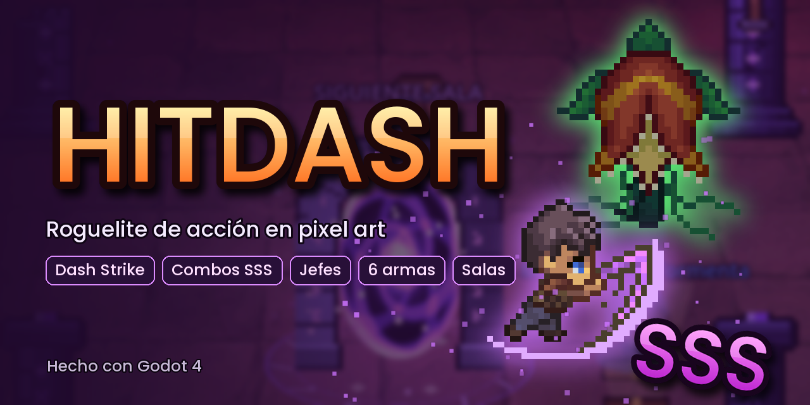
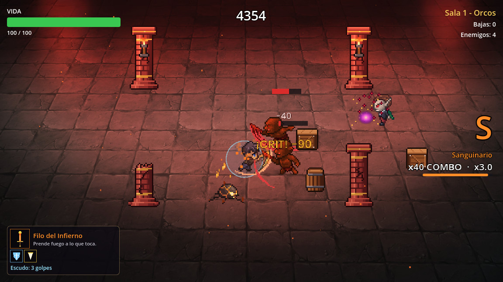
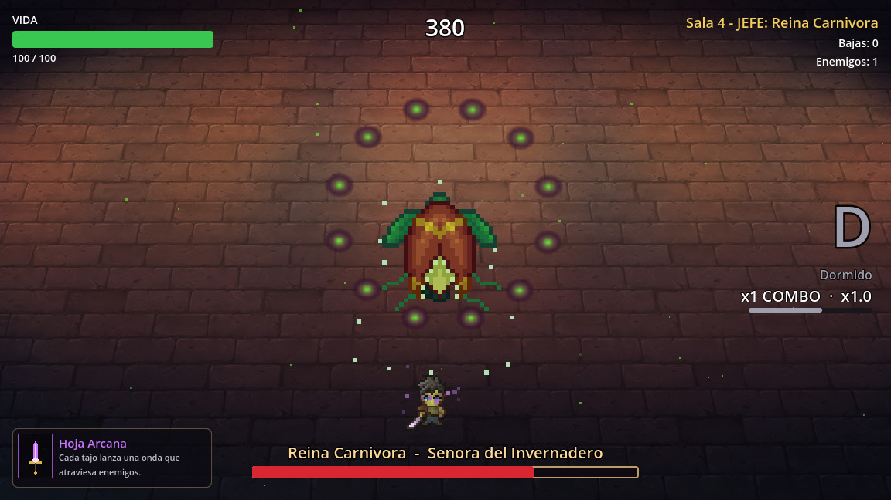
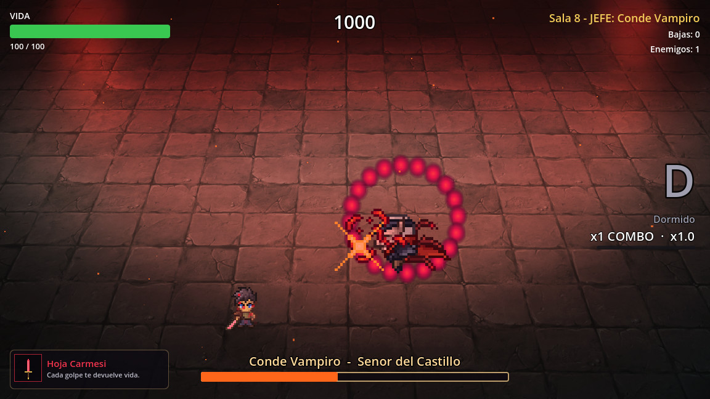
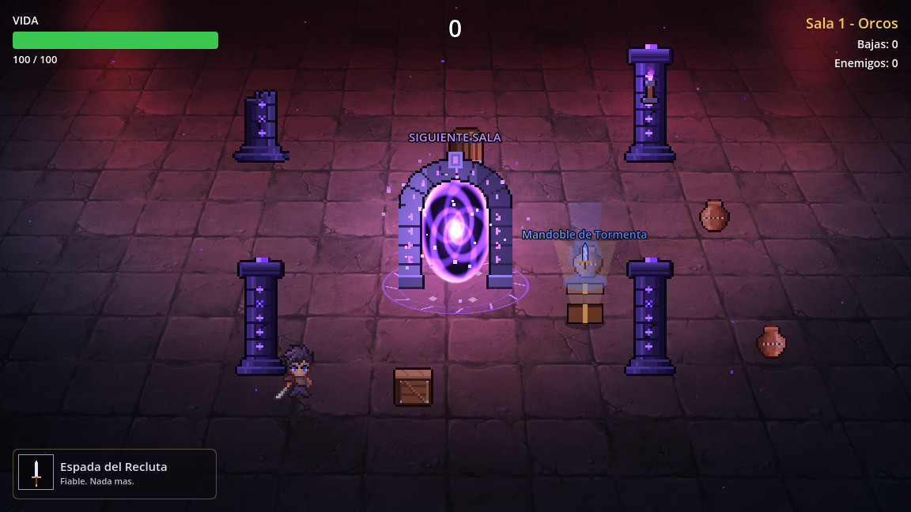
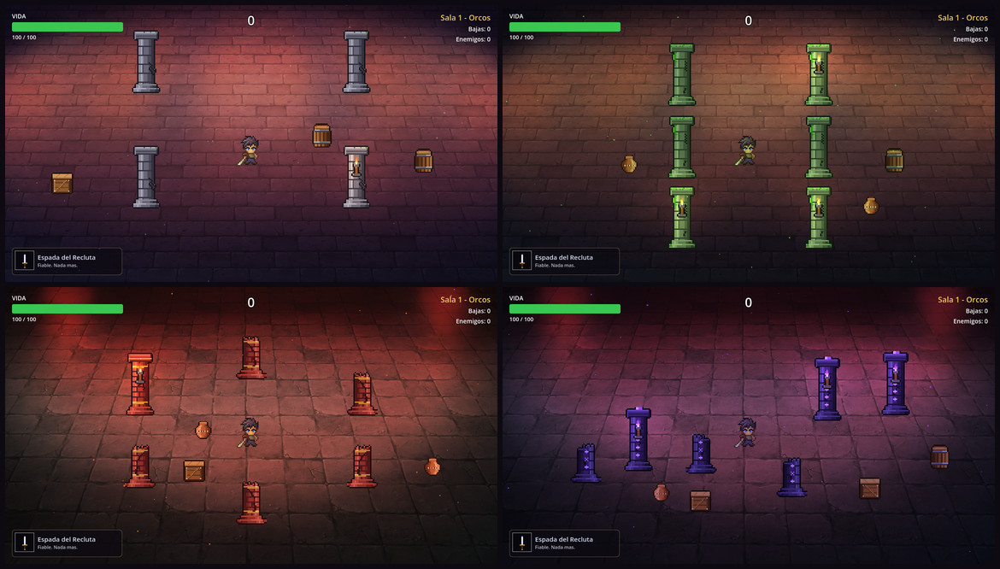
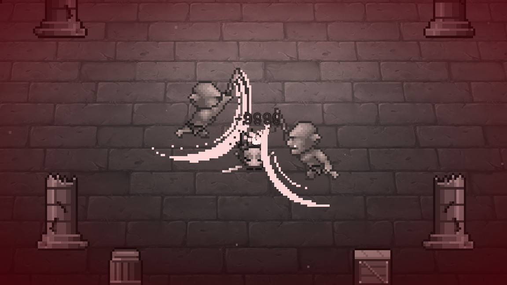

<p align="center">
  
</p>

<p align="center">
  <b>Roguelite de acción en pixel art.</b> Despeja salas, encadena combos hasta el rango <b>SSS</b>,<br>
  roba las armas de los jefes y cruza el portal a la siguiente sala. Hecho con Godot 4.
</p>

<p align="center">
  
  
  
</p>

---

## 🎮 El juego

Eres un espadachín atrapado en una mazmorra que cambia a cada paso. Cada sala trae una tanda de enemigos; cuando caen todos aparecen un **cofre** y un **portal** hacia la siguiente. Por el camino te esperan dos jefes, armas con poderes propios y reliquias que se acumulan durante la partida.

La mecánica central da nombre al juego: el **Dash Strike**. El dash golpea a todo lo que atraviesas y, si mata a alguien, **se recarga al instante**. Bien encadenado, puedes cruzar una sala entera de enemigo en enemigo.

<p align="center">
  
  <br><sub>Combo x40 en rango S con el Filo del Infierno: críticos, quemadura y escudo de la Égida.</sub>
</p>

## ✨ Características

**Combate con buen game feel**
- **Hit-stop**, temblor de cámara y empujón en cada golpe; más fuerte con críticos y remates.
- **Golpes críticos** con números de daño dorados.
- **Combos con rango de estilo**: D → C → B → A → S → SS → **SSS**. El rango multiplica los puntos (hasta ×4) y la ventana para seguir el combo se acorta cuanto más alto estás. Si te golpean, lo pierdes.

**Salas estilo roguelite**
- Cada sala tiene una distribución distinta de **columnas** (cubren de los proyectiles) y **cajas, barriles y vasijas** rompibles que a veces sueltan vida.
- Antes de aparecer, cada enemigo marca el suelo con un círculo rojo.
- Los enemigos **rodean los obstáculos** con un mapa de navegación que se genera en cada sala.
- Al despejarla cae un **portal**: un arco de piedra con un vórtice que se acelera cuando te acercas.

**Jefes**
| Reina Carnívora | Conde Vampiro |
|:---:|:---:|
|  |  |
| Embiste con aviso previo y llena la sala de semillas. En **fase 2** dispara en espiral e invoca plantas escupidoras. | Te rodea a distancia, se teletransporta y lanza abanicos y novas de sangre. En **fase 2** dispara doble e invoca vampiros. |

Los dos tienen entrada dramática, barra de vida propia, su propia música y **siempre sueltan un arma**. En el modo infinito vuelven cada vez más fuertes.

**Armas y reliquias**

Las armas se recogen con <kbd>E</kbd> y **se ven en el personaje**: la espada cambia de color, la estela del tajo también, y cada una lleva su propia aura.

| Arma | Efecto |
|---|---|
| Espada del Recluta | La de siempre. |
| **Hoja Carmesí** | Cada golpe te devuelve vida. |
| **Mandoble de Tormenta** | Lento y brutal (×1.8 de daño, golpe más amplio); el rayo salta a dos enemigos cercanos. |
| **Dagas Gemelas** | Ataques muy rápidos y +20% de crítico. |
| **Filo del Infierno** | Quema a los enemigos durante 3 segundos. |
| **Hoja Arcana** | Cada tajo lanza una onda que atraviesa enemigos. |

Las reliquias se acumulan y se cogen con solo pasar por encima: **Corazón de Dragón** (+25 de vida máxima), **Botas Aladas** (velocidad y dash más frecuente), **Colmillo Afilado** (más crítico), **Piedra de Afilar** (+20% de daño), **Égida** (escudo de 3 golpes) y **Reloj de Arena** (más tiempo para combos).

<p align="center">
  
  <br><sub>Sala despejada: el portal a la siguiente sala y un cofre con un arma nueva.</sub>
</p>

**Cuatro escenarios**

Mazmorra, Invernadero maldito, Castillo carmesí y Abismo. Cada uno tiene su propio suelo, su tinte de color, partículas de ambiente, columnas propias y antorchas con luz dinámica.

<p align="center">
  
</p>

**Y además**
- Muerte cinematográfica: cámara lenta, zoom, la pantalla pierde el color y se cierra una viñeta roja.
- Orbes de vida, menú de pausa y récords guardados (puntuación, combo máximo y tiempo).
- Sonido y música **generados por código**, sin samples externos.

<p align="center">
  
</p>

## 🕹️ Controles

| Acción | Tecla |
|---|---|
| Moverse | <kbd>W</kbd> <kbd>A</kbd> <kbd>S</kbd> <kbd>D</kbd> |
| Atacar | <kbd>J</kbd> o clic izquierdo |
| Dash | <kbd>Espacio</kbd> |
| Equipar arma | <kbd>E</kbd> |
| Pausa | <kbd>Esc</kbd> |
| Reiniciar (en Game Over) | <kbd>Enter</kbd> |

## 🚀 Cómo ejecutarlo

1. Instala [Godot 4.7](https://godotengine.org/download) (sirve la versión estándar).
2. Clona el repo:
   ```bash
   git clone https://github.com/JCarvajalr/Hitdash.git
   ```
3. Abre Godot, pulsa **Importar** y elige el `project.godot` de la carpeta.
4. Pulsa <kbd>F5</kbd>. La escena principal es `Scenes/arena.tscn`.

> La primera vez Godot importa todos los recursos; puede tardar unos segundos.

## 🗂️ Estructura del proyecto

```
Entities/
  Character/     Jugador: movimiento, dash, ataques, armas y reliquias
  Enemies/       Orcos, slimes, vampiros y plantas
  Bosses/        Clase base Boss y los dos jefes
  Pickups/       Cofres, orbes de vida y objetos en el suelo
  Effects/       Números de daño, efectos de armas, muerte y aspecto del arma
  Projectiles/   Proyectiles mágicos
Scenes/
  arena.*        Escena principal: salas, escenarios, portal, música y botín
  enemy_spawner  Salas y oleadas: qué sale, cuándo y cuándo se despeja la sala
  hud, pause_menu, game_over_screen
  rooms/         Generador de salas, columnas, cajas y portal
Systems/         Autoloads y utilidades
  combat.gd      (autoload Combat) hit-stop, temblor, combos, puntos y récords
  sfx.gd         (autoload Sfx) efectos de sonido y música
  items.gd       Catálogo de armas y reliquias, y sus iconos
  pathing.gd     Navegación de enemigos alrededor de obstáculos
sounds/          Audio generado por tools/gen_sfx.py
sprites/         Personajes, fondos, fuentes y props (sprites/props: tools/gen_props.py)
tools/           Scripts que generan audio, pixel art y la miniatura
docs/            Miniatura y capturas del README
```

## 🛠️ Cómo ampliarlo

- **Una sala nueva:** añade una distribución en `Scenes/rooms/room_builder.gd` (lista `LAYOUTS` y su caso en `build()`).
- **Un arma:** añade una entrada en `Items.WEAPONS` (`Systems/items.gd`). Para un efecto nuevo, implementa su caso en `_apply_weapon_effect()` del jugador y su aura en `Entities/Effects/weapon_look.gd`.
- **Un jefe:** hereda de `Boss` (`Entities/Bosses/boss.gd`) y define `_build_frames()`, `_think()` y `_choose_attack()`. La base ya trae fases, avisos visuales, anillos y abanicos de proyectiles, e invocaciones.
- **El orden de salas y oleadas:** está en `_default_waves()` de `Scenes/enemy_spawner.gd`.

### Recursos generados por código

El audio, los props en pixel art y la miniatura salen de scripts con semilla fija, así que son originales y siempre dan el mismo resultado. Para regenerarlos (requiere Python 3 y Pillow):

```bash
python tools/gen_sfx.py        # efectos de sonido y música -> sounds/
python tools/gen_props.py      # columnas, cajas, portal, antorchas -> sprites/props/
python tools/gen_thumbnail.py  # miniatura del repo -> docs/thumbnail.png
```

## 👥 Equipo

- [JCarvajalr](https://github.com/JCarvajalr)
- Santos Enmanuel

Los sprites de personajes y fondos de `sprites/characters` y `sprites/background` son de terceros: revisa su licencia antes de distribuir el juego.
